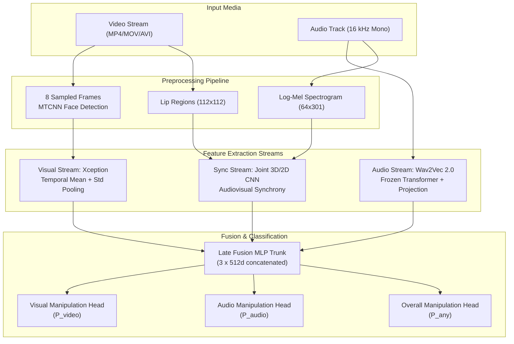

# Multimodal Deepfake Detection Studio

[](https://www.python.org/)
[](https://pytorch.org/)
[](https://flask.palletsprojects.com/)
[](#testing--verification)
[](https://github.com/DASH-Lab/FakeAVCeleb)

A deep learning system for detecting multimodal deepfakes across video, speech, and audiovisual synchrony. Features a multi-task late fusion detector (Xception + Wav2Vec 2.0 + 3D/2D SyncStream), a standalone sliding-window audio classifier, an interactive web UI, command-line forensic tools, and a modular training suite.

> **Disclaimer**: This is a research demonstration project and not an infallible forensic verification service. Deepfake detection models can produce false positives or false negatives, especially when tested on out-of-distribution media formats, extreme compression, or unfamiliar audio conditions.

---

## Architecture Overview

Modern deepfakes often alter only one stream (e.g. lipsyncing real speech with Wav2Lip, or cloning a voice over genuine footage). A single binary label fails on these nuanced manipulations. This project uses a **multi-task architecture** that inspects each modality independently while fusing them for a combined verdict:



---

## Project Structure

The project has been refactored into clean, professional, decoupled modules:

```text
multimodal-deepfake-detection/
├── src/deepfake_detector/       # Core reusable library
│   ├── __init__.py              # Package exports (Predictors, Models, Utils)
│   ├── config.py                # Hyperparameters, dimensions, constants
│   ├── model.py                 # PyTorch architectures (MultiTask, Streams, AudioClassifier)
│   ├── preprocessing.py         # MTCNN face extraction, lip crop, audio spectrograms
│   ├── inference.py             # Multimodal video inference engine & verdict interpretation
│   ├── audio_inference.py       # Standalone sliding-window audio predictor
│   └── reporting.py             # Forensic report builder and risk level scoring
├── training/                    # Dedicated model training suite
│   ├── train_multimodal.py      # Multi-task training pipeline (scan, train, eval, ablation)
│   ├── train_audio.py           # Standalone audio classifier training pipeline
│   ├── dataset_audit.py         # FakeAVCeleb dataset scanner & corruption checker
│   ├── smoke_test.py            # Fast 1-batch training verification test
│   ├── syncnet_test.py          # Lip-sync discriminative analysis
│   ├── syncnet_score_testset.py # Test-split SyncNet confidence scoring
│   ├── post_processing.py       # Threshold calibration, TTA & temperature scaling
│   ├── cross_attention.py       # Cross-attention multimodal fusion variant
│   ├── live_monitor.py          # Real-time training loss/metric curve plotter
│   ├── run_train.sh             # Training execution launcher with Google Drive sync
│   ├── colab_quickstart.md      # Google Colab multimodal training walkthrough
│   ├── audio_only_quickstart.md # Standalone audio model training guide
│   └── README.md                # Detailed training suite documentation
├── ui/                          # Web dashboard interface
│   ├── app.py                   # Flask server and REST API endpoints
│   ├── templates/index.html     # Modern dark-mode dashboard
│   ├── static/                  # Responsive styling (CSS) and client interactions (JS)
│   ├── samples/                 # Local evaluation media clips
│   ├── uploads/                 # Ephemeral runtime uploads (git-ignored)
│   └── README.md                # Web UI guide and API reference
├── tests/                       # Comprehensive automated test suite
│   ├── test_models.py           # Neural network layer and tensor shape tests
│   ├── test_preprocessing.py    # MTCNN cropping math and tensor normalization tests
│   ├── test_inference.py        # Verdict interpretation and label inference tests
│   ├── test_ui.py               # Flask endpoints, upload validation & security tests
│   ├── test_cli.py              # CLI argument parser and summary renderer tests
│   ├── test_reporting.py        # Forensic report generation and risk rating tests
│   └── test_config.py           # Configuration constant and dimension tests
├── scripts/                     # Command-line forensic utilities
│   ├── analyze_video.py         # Single-video CLI inference with JSON export
│   └── summarize_results.py     # Evaluation artifact markdown generator
├── models/                      # Checkpoint storage (ignored by git)
│   ├── best_model.pt            # Trained multimodal detector (476 MB)
│   ├── audio_model.pt           # Trained standalone audio detector (864 KB)
│   └── README.md                # Checkpoint placement instructions
├── results/                     # Historical evaluation results & benchmark plots
├── docs/                        # Architecture and technical specifications
├── .env.example                 # Environment variable templates
└── requirements.txt             # Project dependencies
```

---

## Getting Started

### Prerequisites

- **Python**: 3.10, 3.11, 3.12, 3.13, or 3.14
- **FFmpeg**: Must be installed and accessible on your system `PATH`
- **GPU** *(Optional)*: NVIDIA GPU with CUDA recommended for training; CPU is fully supported for inference.

### 1. Environment Installation

Clone the repository and set up a virtual environment:

#### Windows PowerShell:
```powershell
git clone https://github.com/your-username/multimodal-deepfake-detection.git
cd multimodal-deepfake-detection

python -m venv .venv
.venv\Scripts\Activate.ps1
python -m pip install --upgrade pip
pip install -r requirements.txt
```

#### Linux / macOS:
```bash
git clone https://github.com/your-username/multimodal-deepfake-detection.git
cd multimodal-deepfake-detection

python3 -m venv .venv
source .venv/bin/activate
python -m pip install --upgrade pip
pip install -r requirements.txt
```

### 2. Model Checkpoints

Download or place your trained checkpoints inside the `models/` folder:

```text
models/
├── best_model.pt     # Multimodal video detector weights
└── audio_model.pt    # Standalone audio detector weights
```

You can also specify custom checkpoint paths using environment variables:

```powershell
$env:MODEL_PATH = "D:\checkpoints\best_model.pt"
$env:AUDIO_MODEL_PATH = "D:\checkpoints\audio_model.pt"
```

---

## Running the Web User Interface

Launch the web studio from the project root:

```powershell
# Windows
python ui/app.py

# Linux / macOS
python3 ui/app.py
```

Open `http://127.0.0.1:5000` in your web browser.

### Key UI Features:
- **Multimodal Video Analysis**: Upload an MP4/MOV/AVI video or select a sample clip to inspect visual artifacts, audio authenticity, and lip-sync synchronization.
- **Standalone Audio Scanner**: Upload WAV, MP3, M4A, FLAC, OGG, or AAC recordings. The detector scans full-duration audio in overlapping 3.0-second sliding windows and highlights suspicious time segments.
- **Detailed Forensic Reports**: View confidence percentages, timing breakdowns, and download a machine-readable JSON report.
- **Graceful Fault Tolerance**: If a model checkpoint is missing, the interface remains operational and clearly displays which model needs to be supplied.

---

## Command Line Analysis

Run batch or single-video analysis directly from your terminal:

```bash
python scripts/analyze_video.py --video sample.mp4 --threshold 0.5
```

### Export Machine-Readable JSON:

```bash
python scripts/analyze_video.py --video sample.mp4 --json --output report.json
```

Output:
```json
{
  "summary": "FAKE (video) decision with high risk. Strongest signal: visual stream.",
  "risk": "high",
  "threshold": 0.5,
  "scores": {
    "video": 0.9412,
    "audio": 0.0821,
    "any": 0.9125
  },
  "decision": {
    "label": "FAKE (video)",
    "sub": "Visual manipulation detected (e.g., face swap or altered lip movements).",
    "severity": "danger"
  },
  "findings": [
    "The visual stream crossed the fake threshold.",
    "Face detection confidence was 0.998.",
    "Audio RMS was 0.0412."
  ]
}
```

---

## Model Training

All training and evaluation scripts reside in the dedicated [`training/`](training/) directory. Training utilizes the [FakeAVCeleb v1.2](https://github.com/DASH-Lab/FakeAVCeleb) dataset.

### Step 1: Configure Environment and Scan Dataset

```powershell
$env:DATASET_ROOT = "D:\data\FakeAVCeleb_v1.2\FakeAVCeleb_v1.2"
$env:WORK_DIR = "D:\deepfake-work"

python training/train_multimodal.py --stage scan
```

The scan audits dataset media and generates subject-disjoint splits (`meta_train.csv`, `meta_val.csv`, `meta_test.csv`) to prevent identity leakage between training and testing.

### Step 2: Train Multimodal Model

```bash
python training/train_multimodal.py --stage train --epochs 12 --batch 24 --workers 4
```

### Step 3: Evaluate and Run Ablations

```bash
# Evaluate test split metrics
python training/train_multimodal.py --stage eval

# Run stream ablation comparison
python training/train_multimodal.py --stage ablation
```

### Step 4: Train Standalone Audio Classifier

```bash
# 1. Extract Wav2Vec 2.0 embeddings across complete recordings
python training/train_audio.py --stage extract --extract-batch 8

# 2. Train sliding-window binary classifier
python training/train_audio.py --stage train --epochs 30 --batch 256 --patience 5
```

For cloud training in Google Colab with GPU acceleration, refer to the [Colab Training Guide](training/colab_quickstart.md).

---

## Benchmark Evaluation Results

Evaluated on the held-out subject-disjoint test set of FakeAVCeleb v1.2 ($N = 3,276$ videos across 75 unique identities):

### Task Metrics

| Head | Accuracy | ROC AUC | F1 Score | Recall |
|---|---:|---:|---:|---:|
| **Video Stream** | 0.9988 | **0.9991** | 0.9994 | 0.9987 |
| **Audio Stream** | 0.9878 | **0.9982** | 0.9875 | 0.9971 |
| **Combined (Any Head)** | **0.9982** | **0.9994** | **0.9984** | **0.9984** |

### Category Breakdown

| Category Code | Description | Count ($N$) | Accuracy | Recall | F1 Score |
|---|---|---:|---:|---:|---:|
| **R-R** | Real Video + Real Audio (Control) | 75 | 0.9733 | — | — |
| **F-R** | Fake Video + Real Audio (Wav2Lip / FaceSwap) | 1,485 | 0.9973 | 0.9973 | 0.9987 |
| **R-F** | Real Video + Fake Audio (Synthetic Voice / TTS) | 75 | 0.9333 | 0.9333 | 0.9655 |
| **F-F** | Fake Video + Fake Audio | 1,641 | 1.0000 | 1.0000 | 1.0000 |

### Modality Ablation Study

| Configuration | Combined AUC | Combined F1 | Video AUC | Audio AUC |
|---|---:|---:|---:|---:|
| Visual Stream Only (Xception) | 0.9842 | 0.9821 | 0.9871 | — |
| Audio Stream Only (Wav2Vec 2.0) | 0.9514 | 0.9480 | — | 0.9823 |
| Sync Stream Only (Joint 3D/2D CNN) | 0.9230 | 0.9185 | 0.9120 | 0.9150 |
| **Full Multimodal Fusion (Ours)** | **0.9994** | **0.9984** | **0.9991** | **0.9982** |

---

## Testing & Verification

The project includes an automated test suite with **36 unit and integration tests** covering models, preprocessing, inference, reporting, CLI utilities, and Flask routes.

Run the test suite with Python's built-in `unittest`:

```bash
python -m unittest discover -s tests -v
```

Or with `pytest`:

```bash
pytest tests
```

---

## License & Attribution
“Based on multimodal-deepfake-detection by Nur Yağmur Tuncer (MIT)”.
- **Dataset**: Research using FakeAVCeleb must cite the original dataset creators. See the [FakeAVCeleb repository](https://github.com/DASH-Lab/FakeAVCeleb) for terms of use.
- **Pretrained Encoders**: Uses HuggingFace `facebook/wav2vec2-base-960h` and timm `xception`.