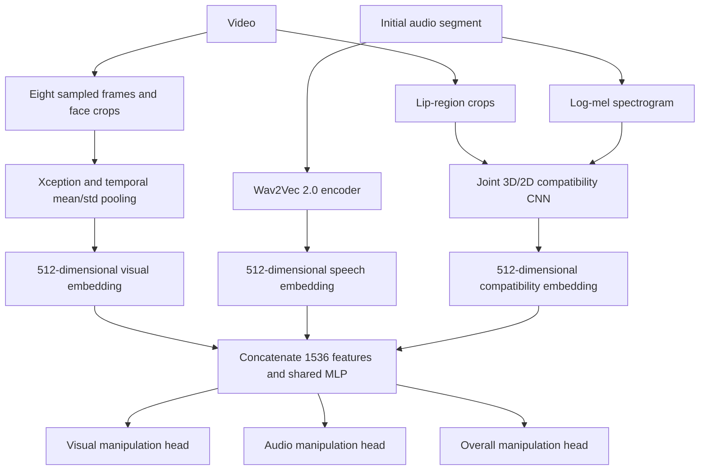

# Multimodal Deepfake Detection Studio

[](requirements.txt)
[](requirements.txt)
[](ui/app.py)

A research application for analyzing manipulated video and synthetic speech. The project combines **Xception**, **Wav2Vec 2.0**, and a **3D/2D audiovisual compatibility stream** for multimodal inference, with a separate audio scanner offering selectable Wav2Vec and AASIST detectors.

The Flask Studio provides media uploads, model selection, recording scores, diagnostic timelines, segment playback, and video-report export. The repository also includes training workflows, a pinned AASIST dependency, evaluation artifacts, and presentation material.

**Current status - 12 November 2026:** a supplied fine-tuned AASIST checkpoint has been integrated and tested locally. Its validation AUC is strong, but it still incorrectly flags all four provisionally real recordings in the reserved eight-clip test. Independent recording calibration and final ASVspoof evaluation outputs were not included in the supplied exports. Treat the application as a research prototype.

[Quick start](#quick-start) | [Models and checkpoints](#models-and-checkpoints) | [Architecture](#architecture) | [Evaluation results](#evaluation-results) | [Training](#training) | [Reports and presentation](#reports-and-presentation)

## Features

- Multimodal predictions for visual manipulation, audio manipulation, and overall manipulation.
- Standalone audio scanning with a detector dropdown: Studio Wav2Vec, Phase 1 Wav2Vec, AASIST, and AASIST-L.
- Detector-specific sliding windows, raw score timelines, recording thresholds, and timestamp-linked playback.
- Shared audio adapters with explicit class mapping, score direction, calibration checks, and stage timings.
- Reproducible evaluation and a Colab workflow for dataset download, AASIST fine-tuning, calibration, and export.

## Quick start

### Prerequisites

- Python 3.10+ with a compatible set of packages from [requirements.txt](requirements.txt). Package and wheel availability varies by Python version and platform.
- Git with submodule support.
- FFmpeg available on `PATH`; check with `ffmpeg -version`.
- A CUDA GPU for the supplied AASIST fine-tuning workflow. CPU inference is supported.
- Separate project-trained checkpoints for the model features you want to use; see the next section.

### 1. Clone the project and its dependency

```powershell
git clone --recurse-submodules https://github.com/Abhijeet12N/Multimodal-deepfake.git
cd Multimodal-deepfake
```

For an existing clone:

```powershell
git submodule update --init --recursive
```

AASIST is pinned at `third_party/aasist` to commit `a04c9863f63d44471dde8a6abcb3b082b07cd1d1`. Its source, license, notice, and official baseline checkpoints come from that upstream revision. A sibling `../aasist` checkout is no longer required. See [dependency details](third_party/README.md).

### 2. Install the environment

Windows PowerShell:

```powershell
python -m venv .venv
.\.venv\Scripts\Activate.ps1
python -m pip install --upgrade pip
python -m pip install -r requirements.txt
```

Linux/macOS:

```bash
python3 -m venv .venv
source .venv/bin/activate
python -m pip install --upgrade pip
python -m pip install -r requirements.txt
```

Run the remaining commands from the project root. Wav2Vec-backed models may download their pretrained encoder on first use; offline execution requires those files to be cached already.

### 3. Place checkpoints and configure paths

The main repository does not contain project-trained checkpoints or datasets. Obtain the required checkpoint files separately and place them as described below. The initialized AASIST submodule includes the official AASIST/AASIST-L baselines, so those audio choices do not require a project-trained checkpoint.

Optionally create `.env` from [.env.example](.env.example) without replacing an existing file:

```powershell
if (-not (Test-Path .env)) { Copy-Item .env.example .env }
```

Edit checkpoint paths only where needed. Audio detector selection happens in the UI dropdown, not through an `AUDIO_DETECTOR` setting.

### 4. Start the Studio

```powershell
python ui/app.py
```

Open **http://127.0.0.1:5000**. Stop the server with **Ctrl+C**. Missing checkpoints are reported in the UI; the corresponding analysis path remains unavailable until its checkpoint is installed. Restart the server after changing checkpoint paths or installing a different model.

## Models and checkpoints

| Model or feature | Checkpoint location | Availability |
|---|---|---|
| Multimodal video analysis | `models/best_model.pt` | Project-trained; supply separately |
| Studio Wav2Vec + MLP | `models/audio_model.pt` | Project-trained; supply separately |
| Phase 1 Wav2Vec + MLP | `LEGACY_AUDIO_CHECKPOINT_PATH` | Separate Phase 1 checkpoint; the older sibling workspace path remains a fallback |
| Fine-tuned AASIST | `models/aasist_finetuned.pth` | Selected supplied export; local file excluded from Git |
| Pretrained AASIST | `third_party/aasist/models/weights/AASIST.pth` | Included in the pinned upstream submodule |
| Pretrained AASIST-L | `third_party/aasist/models/weights/AASIST-L.pth` | Included in the pinned upstream submodule |

The selected fine-tuned export is run **20261108_060713, epoch 4**. When `models/aasist_finetuned.pth` is installed and no explicit override points elsewhere, the Studio defaults to **AASIST (fine-tuned)**. Without it, the initial dropdown selection remains the Studio Wav2Vec model; choose an available AASIST baseline in the dropdown if the Studio checkpoint is missing.

AASIST checkpoint lookup respects an explicit path override, then prefers the installed fine-tuned model, followed by the submodule baseline and older workspace layouts. Other detectors remain selectable. Checkpoint architectures are not interchangeable: `wav2vec_best.pt`, `audio_model.pt`, and AASIST weights serve different model classes.

| UI detector ID | Representation | Window / hop |
|---|---|---|
| `legacy_standalone` | Wav2Vec contextual embeddings + Studio MLP | 3 s / 1.5 s |
| `legacy_wav2vec_mlp` | Wav2Vec CNN features + Phase 1 MLP | 2 s / 1 s |
| `aasist` | Raw-waveform spectro-temporal graph attention | 4.0375 s / 2 s |
| `aasist_l` | Compact AASIST configuration | 4.0375 s / 2 s |

SSL-AASIST and XLSR-MamBo adapters exist as research paths. They are not additional working choices in the current Studio dropdown. SSL-AASIST work is deferred; no completed local XLSR-MamBo evaluation is established.

### Configuration

The Flask app loads `.env` without overriding environment variables that are already set.

| Variable | Purpose |
|---|---|
| `MODEL_PATH` | Multimodal checkpoint; default `models/best_model.pt` |
| `AUDIO_MODEL_PATH` | Studio Wav2Vec checkpoint; default `models/audio_model.pt` |
| `LEGACY_AUDIO_CHECKPOINT_PATH` | Phase 1 `wav2vec_best.pt`; otherwise uses the older `../initial setup/deepfake_phase1/checkpoints/` location |
| `AASIST_CHECKPOINT_PATH` | Optional override of automatic AASIST checkpoint lookup |
| `AASIST_L_CHECKPOINT_PATH` | Optional override for AASIST-L |
| `AUDIO_DEVICE` | Adapter inference device; defaults to `cpu` |
| `FLASK_HOST`, `FLASK_PORT` | Server address; default `127.0.0.1:5000` |

For example, in PowerShell:

```powershell
$env:MODEL_PATH = "D:\checkpoints\best_model.pt"
$env:AASIST_CHECKPOINT_PATH = "D:\checkpoints\aasist_finetuned.pth"
python ui/app.py
```

Checkpoint extensions, `.env`, `ui/uploads/`, model ZIPs under `models/`, extracted exports under `models/finetuned/`, and caches under `work/` are ignored by Git. Keep raw datasets outside the repository and share project-trained weights through a separate artifact download. See [model placement](models/README.md).

## Architecture



The multimodal path samples eight frames, detects a face with MTCNN, and creates 299 x 299 face crops and 112 x 112 lip crops. It processes up to the first three seconds of 16 kHz mono audio and a 64-band log-mel spectrogram. All three output heads receive fused features; they are task-specific predictions rather than independent single-modality classifiers.

The compatibility stream learns audiovisual relationships but does not measure an explicit lip-sync offset. Sparse frame sampling, reuse of a detected face box, and the difference between full-clip frame sampling and initial-segment audio limit temporal alignment on longer videos.

The standalone audio scanner is a separate path. Selecting AASIST in its dropdown does not replace the Wav2Vec branch inside the multimodal video model.

### Standalone audio flow

1. The browser sends the file and detector ID to `POST /api/analyze-audio`.
2. Flask validates the request and loads or reuses the selected checkpoint.
3. The audio service decodes the recording, converts to mono, resamples, and generates model-specific overlapping windows.
4. The adapter scores batches of windows; the shared service aggregates the relevant raw scores for the recording decision.
5. The API returns scores, thresholds, flags, timestamps, calibration status, and timings. JavaScript renders the timeline and linked playback.

The shared service can gate low-energy windows using an RMS heuristic, with a fallback to all windows if none passes. This is not a trained speech recognizer. The older Studio standalone predictor retains its own compatible sliding-window and inconclusive-result policy.

### Reading the results

- Phase 1 Wav2Vec scores increase toward **spoof**; AASIST's raw bona fide logit increases toward **real**.
- The current shared UI service uses a recording mean and decision threshold. Flagged-window counts are diagnostics, not a majority vote or a percentage of fake audio.
- Window scores are not validated confidence percentages. A bona fide prediction does not establish a recording's provenance.
- Recording calibration is used only when its development provenance, model, checkpoint, and pipeline signature match. The supplied fine-tuned AASIST remains uncalibrated at raw threshold **0.0**.

For example, the saved Phase 1 podcast test has a mean score of **0.911344**, below its **0.984982** threshold, despite **45/63** flagged windows. The UI now displays both recording values and qualifies the result as a model prediction.

## Evaluation results

### Historical multimodal benchmark

The saved FakeAVCeleb artifacts contain **3,276 test examples** across real/real, fake/real, real/fake, and fake/fake audio-video combinations. The documented training workflow uses subject-disjoint splits. These saved benchmark results are separate from the current uploaded-audio tests.

| Prediction task | Accuracy | ROC AUC | F1 |
|---|---:|---:|---:|
| Visual manipulation | 99.88% | 0.9991 | 0.9994 |
| Audio manipulation | 98.69% | 0.9982 | 0.9875 |
| Overall manipulation | 99.69% | 0.9994 | 0.9984 |

Source: [results/test_results.json](results/test_results.json). Overall balanced accuracy is approximately **99.19%**. The categories are imbalanced, and overall manipulation recall for real-video/fake-audio examples is **93.33%**. See [per-category results](results/per_category.csv).

The [saved ablation measurements](results/ablation.csv) show different tradeoffs across metrics; removing audio slightly improves overall accuracy in that file. They do not establish that every added stream improves every metric.

### Fine-tuned AASIST validation

| Export | Saved epoch | Validation recordings | ROC AUC |
|---|---:|---:|---:|
| 8 November run - selected | 4 | 10,511 | 0.999649 |
| 12 November run | 2 | 10,511 | 0.999331 |

Both exports use the same validation sample IDs and labels. Selection used the higher recomputed validation AUC before the reserved clips were tested. Neither export includes separate development calibration or final held-out ASVspoof evaluation outputs. See [selection evidence](reports/finetuned_audio_evaluation/selection.json).

### Reserved local audio tests

| Detector | Correct / 8 | Real clips predicted fake / 4 | Fake clips detected / 4 | Inconclusive |
|---|---:|---:|---:|---:|
| Fine-tuned AASIST - selected | 3 | 4 | 3 | 0 |
| Pretrained AASIST | 3 | 4 | 3 | 0 |
| Pretrained AASIST-L | 4 | 4 | 4 | 0 |
| Phase 1 Wav2Vec + MLP | 3 | 3 | 2 | 0 |
| Studio Wav2Vec + MLP | 2 | 0 | 2 | 4 |

The eight clips have provisional labels from their Real/Fake folders and were excluded from fitting and threshold tuning. Inconclusive results count as unresolved. All four provisionally real clips were inconclusive for the Studio Wav2Vec model; its zero false-positive count does not mean it recognized them correctly.

The fine-tuned AASIST produces the same binary decisions as the historical pretrained run on these clips. Its strong validation AUC has not resolved the observed real-audio false positives. This small test is not an estimate of general accuracy. See the [fine-tuned evaluation](reports/finetuned_audio_evaluation/report.md) and [earlier four-model comparison](reports/audio_pipeline_evaluation/report.md).

The historical [native Wav2Vec benchmark](reports/baseline_audio_benchmark/legacy_wav2vec_mlp_manifest_asvspoof2019_eval_native_benchmark_report.json) records AUC **0.9815** and EER approximately **7.13%** on 71,237 cached-feature examples. Those results and timings are not end-to-end uploaded-recording performance.

## Commands and API

Analyze a video and save its JSON report. Create the ignored output folder first (`mkdir -p work` on Linux/macOS):

```powershell
New-Item -ItemType Directory -Force work | Out-Null
python scripts/analyze_video.py --video "path/to/sample.mp4" --model models/best_model.pt --json --output work/video_report.json
```

The CLI requires the multimodal checkpoint.

Compare audio models on a labeled folder containing `Real/` and `Fake/` subdirectories:

```powershell
python scripts/evaluate_local_audio.py --audio-root "path/to/evaluation" --models aasist aasist_l --threads 2 --output work/audio_evaluation
```

This writes CSV, JSONL, summary JSON, and Markdown outputs without fitting thresholds. Use a new output folder to preserve earlier runs. Add `--offline` when cached Wav2Vec frontends must be used without downloads.

| Route | Purpose |
|---|---|
| `GET /` | Studio dashboard |
| `GET /api/status?audio_detector=aasist` | Model availability and active checkpoint information |
| `POST /api/analyze` | Video analysis; multipart `mode=upload` and `file` |
| `POST /api/analyze-audio` | Audio analysis; multipart `file` and optional `detector` |

Windows upload example; use `curl` instead of `curl.exe` on Linux/macOS:

```powershell
curl.exe -X POST http://127.0.0.1:5000/api/analyze-audio -F "detector=aasist" -F "file=@C:\audio\sample.wav"
```

Supported video extensions: MP4, MOV, AVI, MKV. Audio: WAV, MP3, M4A, FLAC, OGG, AAC. The upload limit is **200 MiB**. Audio inference has a local concurrency guard; overlapping requests receive HTTP 429. Invalid inputs, unavailable models, and inference failures return structured errors.

## Training

### Multimodal and Studio Wav2Vec

These workflows use FakeAVCeleb. Training scripts read exported environment variables; the `.env` loader belongs to the Flask app.

```powershell
$env:DATASET_ROOT = "D:\datasets\FakeAVCeleb_v1.2"
$env:WORK_DIR = "work/multimodal_training"
python training/train_multimodal.py --stage scan
python training/train_multimodal.py --stage train --epochs 12 --batch 24 --workers 4
python training/train_multimodal.py --stage eval
python training/train_multimodal.py --stage ablation
```

To extract sliding-window Wav2Vec features and train the Studio classifier using the generated split metadata:

```powershell
python training/train_audio.py --stage extract --extract-batch 8
python training/train_audio.py --stage train --epochs 30 --batch 256 --patience 5
```

Outputs are saved under `WORK_DIR`. Keep the checkpoint paired with its training architecture and preprocessing. See the [training guide](training/README.md) and [multimodal Colab guide](training/colab_quickstart.md).

### AASIST and AASIST-L in Colab

```powershell
python scripts/build_audio_colab_bundle.py
```

Open [AASIST_Colab_Upgrade.ipynb](notebooks/AASIST_Colab_Upgrade.ipynb) in Colab, select a GPU runtime, and upload the generated `artifacts/audio_colab_bundle.zip`. Use the notebook and ZIP from the same project version.

The notebook downloads ASVspoof 2019 LA raw audio directly to Colab storage; no dataset on Drive is needed. It prepares separate training, validation, calibration-development, and final evaluation splits, then exports checkpoints and results. The bundle includes the pinned source and upstream licenses. It excludes `.env`, local fine-tuned exports, and reserved evaluation recordings.

For the supplied AASIST exports, checkpoint training and validation have been inspected locally, but the independent calibration and final evaluation stages remain unverified. Complete those stages using representative development data and retain the eight local clips for evaluation. See the [audio upgrade execution guide](docs/audio_upgrade_execution.md).

## Testing

Focused audio dependency, deployment, training-isolation, Colab workflow, and API contract checks:

```powershell
python -m pytest tests/test_aasist_dependency.py tests/test_finetuned_deployment.py tests/test_audio_training_data.py tests/test_audio_colab_workflow.py tests/test_api_contract.py -q
```

Audio presentation and playback checks require Node.js:

```powershell
node --test tests/test_audio_presentation.cjs
```

To run the full Python suite:

```powershell
python -m pytest tests -q
```

Some integration checks require local checkpoints or cached pretrained encoders. Test coverage includes source discovery, checkpoint provenance, preprocessing parity, calibration compatibility, score interpretation, API behavior, and UI presentation. A software test pass is separate from detection accuracy.

## Reports and presentation

- [PPT generation report - PDF](reports/PPT_Generation_Report.pdf): current project report with a 16-slide outline, speaker notes, suggested visuals, and viva questions.
- [Editable PPT report](reports/PPT_Generation_Report.md): source for presentation preparation.
- [Report index](reports/README.md): current evaluations, native benchmarks, and retained calibration provenance.
- [Multimodal model card](MODEL_CARD.md): intended use and model limitations.
- [Fine-tuned AASIST findings](reports/finetuned_audio_evaluation/report.md): model selection and unresolved local errors.

Regenerate the presentation PDF from the Markdown source:

```powershell
python -m pip install reportlab
python scripts/build_presentation_report.py
```

ReportLab is needed for PDF generation and is not part of the inference requirements. The older `python scripts/generate_project_report.py` command calls the same current generator.

## Project structure

```text
Multimodal-deepfake/
|-- src/deepfake_detector/       # Models, preprocessing, inference, reporting
|   |-- model.py                # Multimodal streams and classifier heads
|   |-- audio_inference.py      # Studio standalone audio predictor
|   |-- upstream.py             # AASIST source and checkpoint discovery
|   `-- audio_detection/        # Adapters, windowing, aggregation, calibration
|-- ui/                         # Flask app, templates, static assets
|-- training/                   # Multimodal/audio training and AASIST fine-tuning
|-- scripts/                    # Evaluation, dataset, packaging, report utilities
|-- notebooks/                  # AASIST Colab upgrade workflow
|-- third_party/aasist/          # Pinned upstream Git submodule
|-- models/                     # Local checkpoints and placement instructions
|-- configs/                    # Detector and calibration configurations
|-- reports/                    # Current PPT report and evaluation evidence
|-- results/                    # Saved multimodal metrics and figures
|-- docs/                       # Architecture, protocols, and upgrade guides
`-- tests/                      # Python and JavaScript regression checks
```

## Troubleshooting

| Symptom | Action |
|---|---|
| AASIST source missing or an uninitialized submodule | Run `git submodule update --init --recursive` from the project root, then restart the app |
| A model is unavailable | Check its checkpoint location and any explicit environment override; trained weights are separate downloads |
| An old checkpoint loads instead of the fine-tuned one | Check `AASIST_CHECKPOINT_PATH`; it takes precedence over automatic lookup |
| Wav2Vec appears slow on first use | Allow the pretrained encoder to load or download; inspect console output and returned timings |
| Recording verdict and many flagged windows differ | Compare the recording mean and decision threshold; flags are a separate diagnostic |
| Real audio is classified as spoof | Review the measured limitations; the current fine-tuned model still has false positives. Do not tune its threshold using the reserved evaluation clips |
| Calibration is ignored | Supply independently fitted recording scores and an artifact matching the checkpoint and pipeline; old native-feature or six-clip artifacts are not accepted |
| Colab dependency errors after an older notebook | Use the current notebook and regenerated ZIP together; the AASIST setup preserves Colab's Transformers/Hub packages |

The main next steps are independent recording-level calibration, final held-out evaluation, broader compressed/multilingual audio testing, and better audiovisual alignment. Model scores and window flags support investigation; they do not independently verify authenticity.

## Attribution

Original project credit: based on `multimodal-deepfake-detection` by Nur Yagmur Tuncer.

- AASIST source: [clovaai/aasist](https://github.com/clovaai/aasist); upstream [MIT license](third_party/aasist/LICENSE) and [notice](third_party/aasist/NOTICE) are retained in the submodule.
- Speech representations: Wav2Vec 2.0 through Transformers; visual backbone: Xception through timm.
- Dataset references and use conditions: [FakeAVCeleb](https://github.com/DASH-Lab/FakeAVCeleb) and the ASVspoof source documented in the [audio upgrade guide](docs/audio_upgrade_execution.md).
